<p align="center">
  
</p>

<h1 align="center">Rippon Girls' College, Galle</h1>

<p align="center">
  <em><strong>"Nisi Dominus Frustra"</strong> — Unless the Lord build the house, they labor in vain</em>
</p>

<p align="center">
  A premier 1AB National School for young women founded in 1871 on the historic heights of Richmond Hill, Galle, Southern Province, Sri Lanka.
</p>

<p align="center">
  <a href="https://nextjs.org/"></a>
  <a href="https://react.dev/"></a>
  <a href="https://www.typescriptlang.org/"></a>
  <a href="https://tailwindcss.com/"></a>
  <a href="https://supabase.com/"></a>
  <a href="https://avishka-kavishan.github.io/Rippon-Girls-College-Website/"></a>
</p>

---

<p align="center">
  🌐 <strong>Live Production Portal:</strong> 
  <a href="https://avishka-kavishan.github.io/Rippon-Girls-College-Website/">
    <strong>https://avishka-kavishan.github.io/Rippon-Girls-College-Website/</strong>
  </a>
</p>

---

## 🏛️ Campus Overview

<p align="center">
  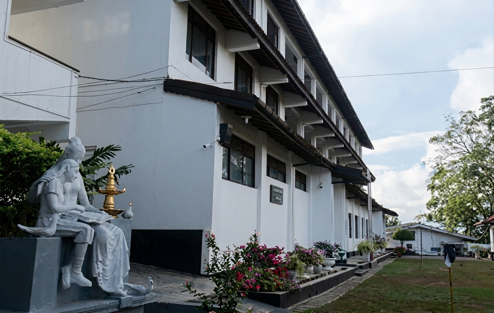
</p>

---

## 📸 Visual Showcase & Previews

Explore key sections and collegiate highlights from the Rippon Girls' College web platform:

### 🏫 Heritage & Campus Facilities
<table>
  <tr>
    <td width="50%" align="center">
      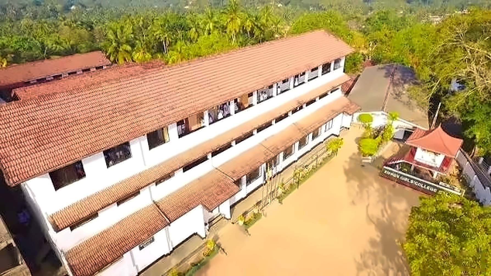
      <br />
      <strong>Historic College Main Hall & Grounds (Est. 1871)</strong>
    </td>
    <td width="50%" align="center">
      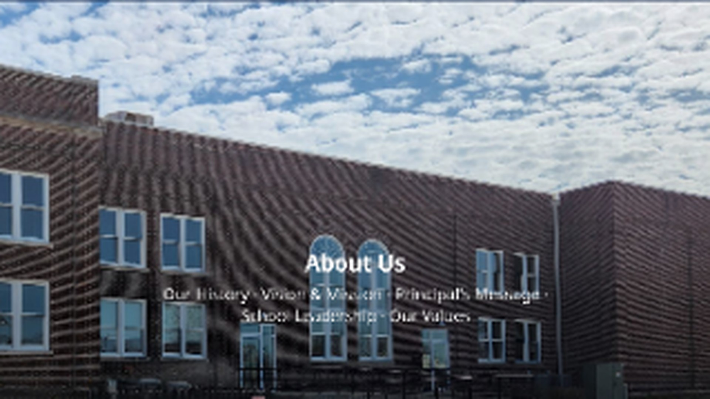
      <br />
      <strong>Richmond Hill Scenic Campus & Learning Environment</strong>
    </td>
  </tr>
</table>

### 🎓 Academic Pathways
<table>
  <tr>
    <td width="33.33%" align="center">
      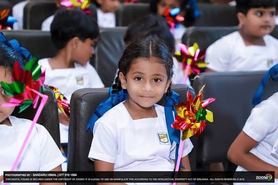
      <br />
      <strong>Primary Section (Grades 1–5)</strong>
      <p><em>Nurturing foundational curiosity, literacy, and holistic development.</em></p>
    </td>
    <td width="33.33%" align="center">
      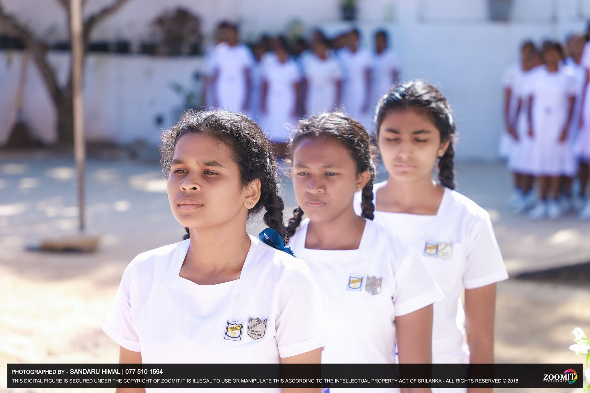
      <br />
      <strong>Secondary Education (Grades 6–11)</strong>
      <p><em>Rigorous bilingual curriculum and national O/L academic preparation.</em></p>
    </td>
    <td width="33.33%" align="center">
      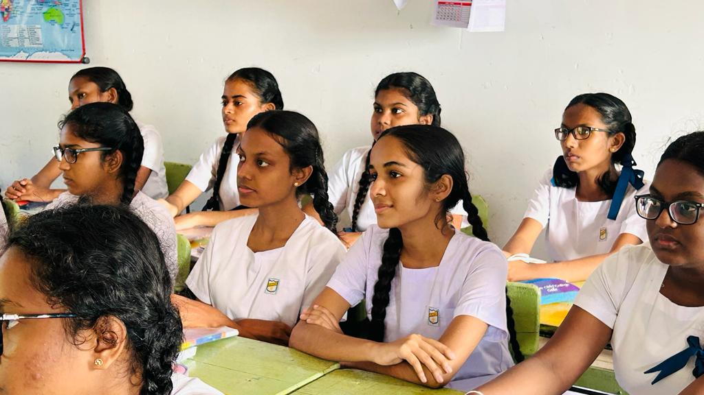
      <br />
      <strong>Collegiate A/L (Grades 12–13)</strong>
      <p><em>5 Advanced streams: Biological, Physical, Commerce, Arts, and Tech.</em></p>
    </td>
  </tr>
</table>

### 🎺 Co-Curricular & Student Life
<table>
  <tr>
    <td width="50%" align="center">
      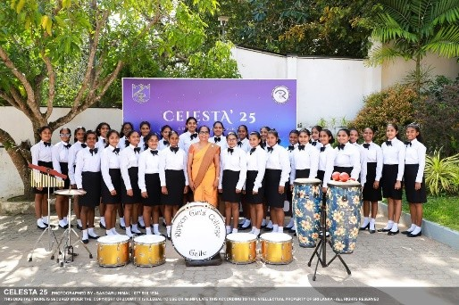
      <br />
      <strong>Rippon Western Brass Band & Musical Ensembles</strong>
    </td>
    <td width="50%" align="center">
      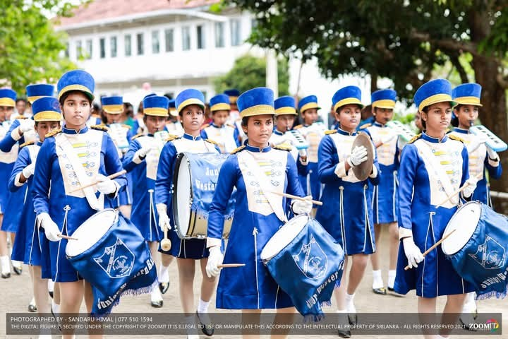
      <br />
      <strong>Sports Meets, Athletics, & Drill Squads</strong>
    </td>
  </tr>
  <tr>
    <td width="50%" align="center">
      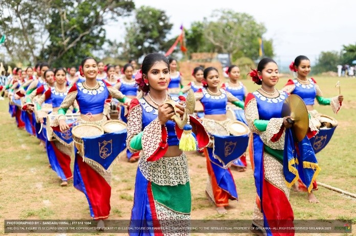
      <br />
      <strong>Aesthetic Studies, Choral Singing, & Cultural Festivals</strong>
    </td>
    <td width="50%" align="center">
      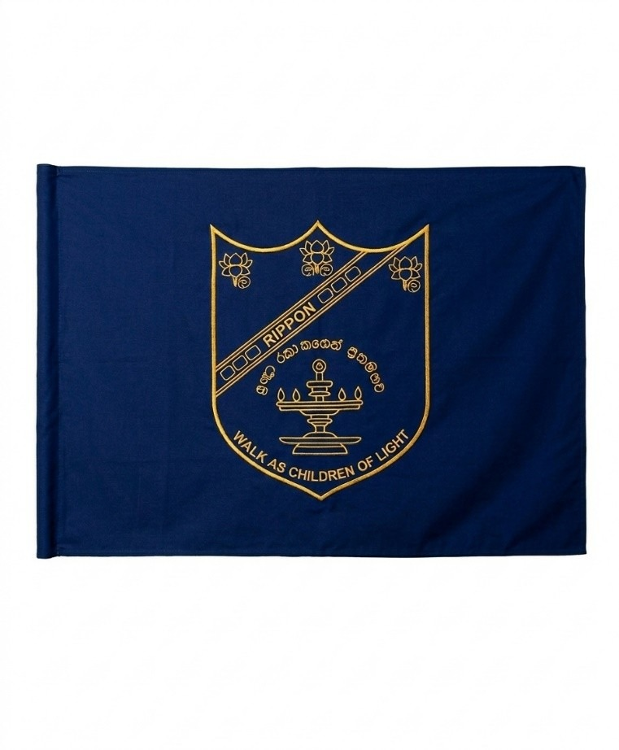
      <br />
      <strong>College House System & Inter-House Competitions</strong>
    </td>
  </tr>
</table>

### 🖼️ Photo Gallery & STEM Highlights
<table>
  <tr>
    <td width="50%" align="center">
      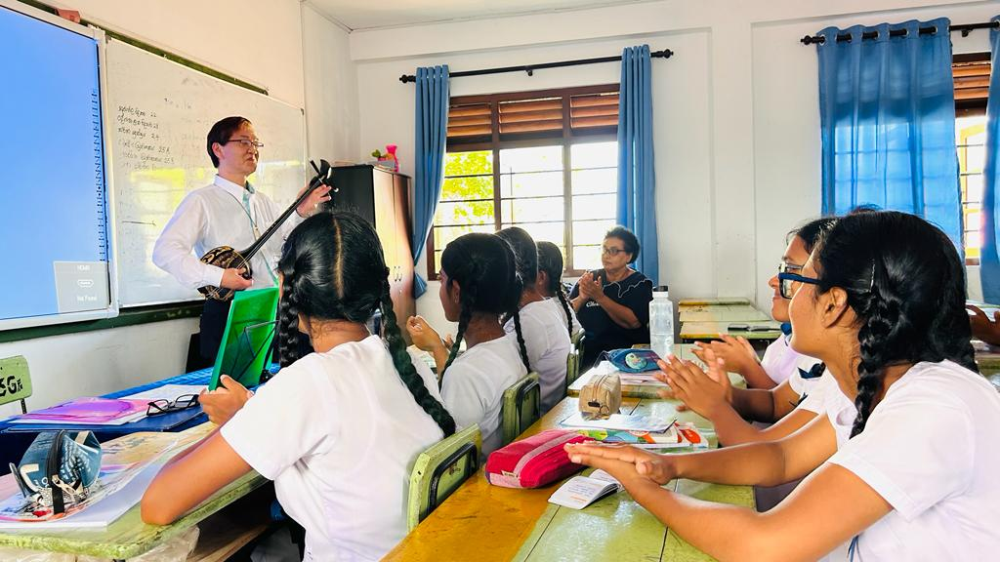
      <br />
      <strong>Student Community & Leadership Guild</strong>
    </td>
    <td width="50%" align="center">
      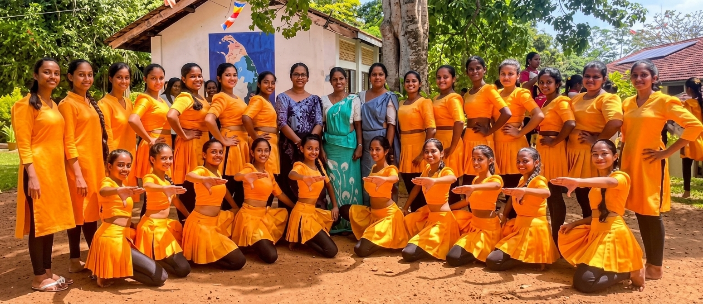
      <br />
      <strong>STEM Laboratories, Robotics, & Digital Innovation</strong>
    </td>
  </tr>
</table>

### 📰 News & Campus Events
<table>
  <tr>
    <td width="50%" align="center">
      
      <br />
      <strong>College Newsroom & Event Coverage Hub</strong>
    </td>
    <td width="50%" align="center">
      
      <br />
      <strong>Annual Prize Giving & Academic Excellence Milestones</strong>
    </td>
  </tr>
</table>

---

## 🌟 Core Modules & Application Features

| Module | Route | Highlights & Features |
| :--- | :--- | :--- |
| **Homepage** | `/` | Hero video/imagery, school motto, principal's greeting, interactive stats counters, academic pathway highlights, campus gallery preview. |
| **About Us** | `/about` | 150+ year historical timeline (1871–Present), Vision & Mission, College Anthem with bilingual translations, student population metrics, executive leadership carousel. |
| **News & Events** | `/news` | Category filters, real-time search, interactive read modal, priority pinned articles, and academic calendar dates. |
| **Gallery** | `/gallery` | Multi-category media browser (Academic, Sports, Arts, Events, Facilities), interactive full-screen lightbox modal with caption details. |
| **Contact Us** | `/contact` | Inquiry form, interactive Google Maps integration, Richmond Hill visiting guidelines, departmental direct lines, and office hours. |
| **Admin CMS** | `/admin` | Live content management system with dual storage modes: **Local Storage** and **Supabase Realtime Cloud Sync**. Real-time dashboard for news, gallery photos, statistics, and received inquiries. |

---

## 🏰 Collegiate Heritage & Houses

Founded in **1871** by **Rev. John Rippon** and **Miss Jane Peake** under the Methodist Missionary Society, Rippon Girls' College has nurtured generations of empowered women, scholars, leaders, and artists across Sri Lanka and worldwide.

### The Four Collegiate Houses
- 🔴 **Bradby House** — Named after Miss Bradby, celebrating courage, loyalty, and perseverance.
- 🔵 **Peake House** — Named in honor of co-founder Miss Jane Peake, symbolizing wisdom, faith, and virtue.
- 🟡 **Rippon House** — Dedicated to founder Rev. John Rippon, representing leadership, integrity, and honor.
- 🟢 **Westlake House** — Honoring Miss Westlake, emphasizing scholarship, duty, and service.

---

## 🛠️ Technology Stack

| Category | Technology | Description |
| :--- | :--- | :--- |
| **Framework** | [Next.js 16](https://nextjs.org/) | App Router, React Server & Client Components, Static Site Generation (`output: "export"`) |
| **Library** | [React 19](https://react.dev/) | Modern concurrent UI architecture and hooks |
| **Language** | [TypeScript 5](https://www.typescriptlang.org/) | Strict type-safety across content schemas, services, and components |
| **Styling** | [Tailwind CSS v4](https://tailwindcss.com/) | Modern CSS utility tokens, custom collegiate color palettes, glassmorphism |
| **Database & CMS** | [Supabase](https://supabase.com/) | Real-time PostgreSQL BaaS for dynamic cloud CMS syncing with local storage fallback |
| **Icons** | [Lucide React](https://lucide.dev/) | Consistent, clean iconography |
| **Typography** | Google Fonts | *Outfit* (Modern body/UI) and *Playfair Display* (Collegiate serif headings) |
| **Deployment** | [GitHub Pages](https://pages.github.com/) | Automated static deployment pipeline via `gh-pages` |

---

## 📁 Project Architecture & Directory Structure

```plaintext
Rippon-Girls-College-Website/
├── public/
│   ├── images/
│   │   ├── news/                  # News cover images & event photos
│   │   ├── about-crest-oval.png   # Official college crest emblem
│   │   ├── Hero_img.jpg           # High-resolution hero banner
│   │   ├── school-building.jpg    # Historic campus architecture
│   │   ├── primary.jpg            # Primary education showcase
│   │   ├── second.jpg             # Secondary education showcase
│   │   ├── advance.jpeg           # Advanced Level education showcase
│   │   ├── band.jpg / band2.jpg   # Western brass band & extracurriculars
│   │   ├── music.jpg              # Aesthetic arts & cultural performances
│   │   └── gallery*.jpg           # Campus gallery & lab photographs
│   └── fonts/                     # Self-hosted typography assets
├── src/
│   ├── app/
│   │   ├── layout.tsx             # Root layout with navbar, footer & context providers
│   │   ├── page.tsx               # Dynamic homepage
│   │   ├── about/                 # History, vision, leadership, facilities
│   │   ├── news/                  # Announcements & event bulletin
│   │   ├── gallery/               # Lightbox gallery & filtering system
│   │   ├── contact/               # Contact directory & inquiry dispatch
│   │   └── admin/                 # CMS Portal (News, Gallery, Stats, Inquiries)
│   ├── components/
│   │   ├── Navbar.tsx             # Responsive glassmorphic navigation header
│   │   └── Footer.tsx             # Collegiate footer with quick links & social portals
│   ├── context/
│   │   └── LanguageContext.tsx    # Multi-language state & localization support
│   ├── data/
│   │   └── defaultData.ts         # Seed data for news, gallery, staff, and statistics
│   ├── lib/
│   │   └── supabase.ts            # Supabase client, storage keys & SQL setup schema
│   ├── services/
│   │   └── contentService.ts      # Data persistence abstraction (Supabase <-> LocalStorage)
│   └── types/
│       └── content.ts             # TypeScript definitions for CMS schemas
├── next.config.ts                 # Next.js configuration (static export, base paths)
├── package.json                   # Project metadata and dependencies
└── tsconfig.json                  # TypeScript compiler configuration
```

---

## ⚡ Getting Started Locally

### Prerequisites
- **Node.js**: v18.17.0 or higher (v20+ recommended)
- **npm**: v9.0.0 or higher (or `pnpm` / `yarn`)
- **Git**: Installed on your system

### 1. Clone the Repository
```bash
git clone https://github.com/Avishka-kavishan/Rippon-Girls-College-Website.git
cd Rippon-Girls-College-Website
```

### 2. Install Dependencies
```bash
npm install
```

### 3. Run the Development Server
```bash
npm run dev
```

Visit [http://localhost:3000](http://localhost:3000) in your web browser to view the application.

---

## ⚙️ Environment Configuration & Supabase Cloud Sync

The application operates seamlessly in **Local Storage Mode** out of the box with zero external configuration required. 

To enable **Multi-Device Live Cloud Sync** via Supabase:

1. Create a free project at [supabase.com](https://supabase.com).
2. Run the following SQL query in the **Supabase SQL Editor**:

```sql
-- 1. Create the site_content table
create table if not exists public.site_content (
  id text primary key,
  data jsonb not null,
  updated_at timestamp with time zone default timezone('utc'::text, now()) not null
);

-- 2. Enable Row Level Security (RLS)
alter table public.site_content enable row level security;

-- 3. Allow public read access to site content
create policy "Public read site_content"
  on public.site_content for select
  using (true);

-- 4. Allow write operations for anon and authenticated users
create policy "Allow all write site_content"
  on public.site_content for all
  using (true)
  with check (true);
```

3. Create a `.env.local` file in your project root:
```env
NEXT_PUBLIC_SUPABASE_URL=https://your-project-id.supabase.co
NEXT_PUBLIC_SUPABASE_ANON_KEY=your-anon-key-here
```

*(Note: You can also configure Supabase credentials dynamically directly within the `/admin` portal settings tab!)*

---

## 🚀 Building & Deployment

### Production Build
Test the production-ready static export:
```bash
npm run build
npm run start
```

### Deploying to GitHub Pages
To build and publish static output directly to the `gh-pages` branch:
```bash
npm run deploy
```

---

## 🤝 Contributing

Contributions that enrich the digital presence of Rippon Girls' College are welcome!

1. **Fork** the repository
2. **Create** your feature branch (`git checkout -b feature/AmazingFeature`)
3. **Commit** your changes (`git commit -m "Add new feature"`)
4. **Push** to your branch (`git push origin feature/AmazingFeature`)
5. **Open** a Pull Request

---

## 📜 License & Copyright

© 2026 **Rippon Girls' College, Galle**. All rights reserved.  
Maintained with pride by the Rippon Girls' College Web Development Team & Past Pupils' Association.
